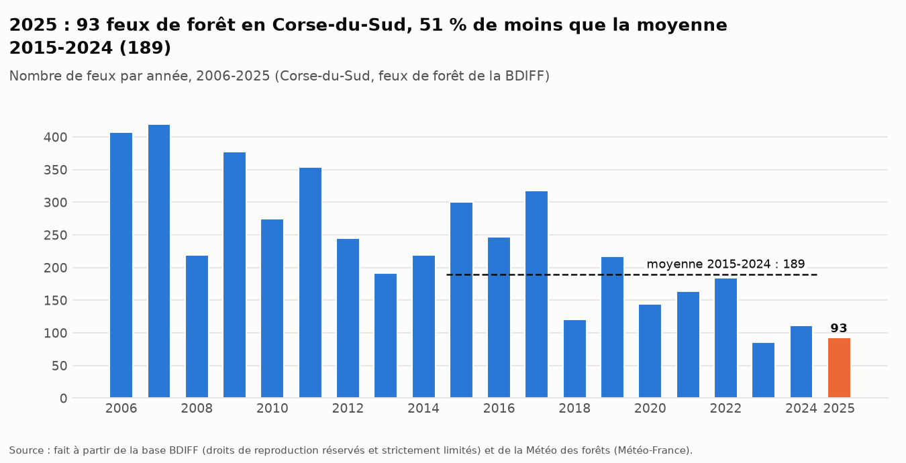
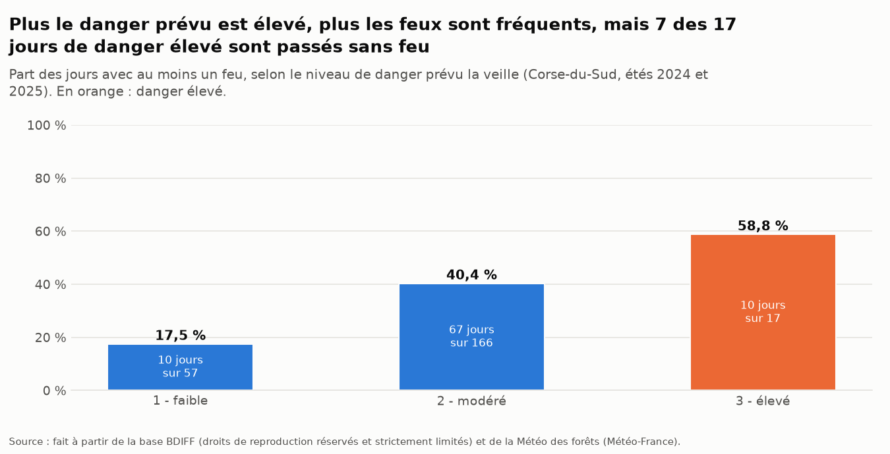
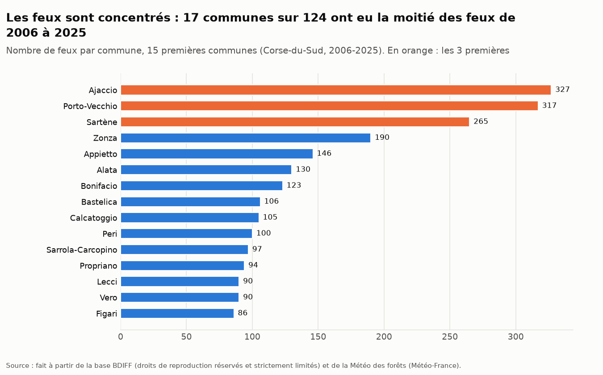
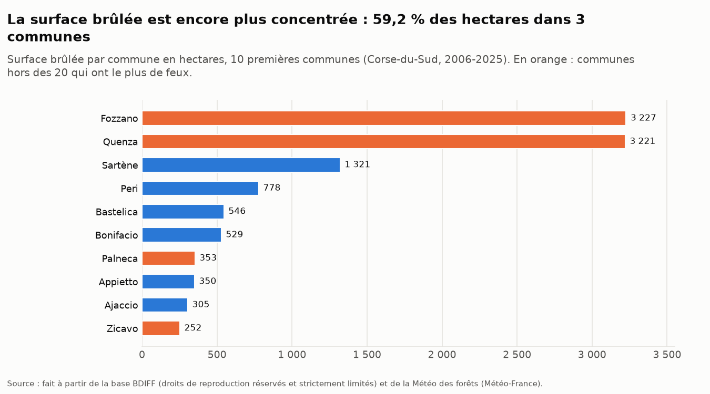

# Tableau de bord : feux de forêt en Corse-du-Sud

Généré par `src/dataviz.py` à partir de la couche or de l'entrepôt (`python src/pipeline.py` puis `python src/dataviz.py`). Tous les chiffres sont calculés depuis les données ; ne pas modifier ce fichier à la main.

**Pour qui :** le directeur du SDIS 2A, qui doit préparer la saison des feux 2027 avant juin 2027.

**Trois questions :** combien de feux et quelle tendance (synthèse) ; le niveau de danger prévu suffit-il à anticiper les feux (pourquoi) ; où concentrer les moyens (détail).

## 1. Synthèse

**2025 : 93 feux de forêt en Corse-du-Sud, 51 % de moins que la moyenne 2015-2024 (189)**

- Moyenne 2015-2024 : 189,2 feux par an et 588 ha brûlés par an ; 2025 : 93 feux et 303 ha.
- Le nombre de feux ne dit pas la surface brûlée : en 2009, les 3 plus grands feux font 93,5 % des 5 533 ha brûlés ; en 2020, les 3 plus grands feux font 98,7 % des 3 204 ha brûlés.

| Année | Feux | Surface brûlée (ha) |
|---|---|---|
| 2006 | 407 | 249,3 |
| 2007 | 420 | 328,2 |
| 2008 | 219 | 98,3 |
| 2009 | 378 | 5 532,6 |
| 2010 | 275 | 82,6 |
| 2011 | 354 | 171,7 |
| 2012 | 245 | 173,2 |
| 2013 | 192 | 47,6 |
| 2014 | 219 | 269,2 |
| 2015 | 300 | 294,7 |
| 2016 | 247 | 51,6 |
| 2017 | 318 | 1 359,1 |
| 2018 | 121 | 15,1 |
| 2019 | 217 | 236,2 |
| 2020 | 144 | 3 203,6 |
| 2021 | 164 | 122,0 |
| 2022 | 184 | 408,2 |
| 2023 | 86 | 97,8 |
| 2024 | 111 | 88,9 |
| 2025 | 93 | 303,1 |

## 2. Pourquoi

**Plus le danger prévu est élevé, plus les feux sont fréquents, mais 7 des 17 jours de danger élevé sont passés sans feu**

- Niveau prévu la veille (`niveau_j1` de la Météo des forêts) ; un feu est rattaché au jour de sa première alerte.
- Les jours de danger faible ne sont pas sans risque : 14 feux sur 139 (10,1 %) ont éclaté un jour de niveau 1.
- Aucun jour de niveau 4 en Corse-du-Sud sur ces deux étés.

| Niveau prévu | Jours | Jours avec au moins un feu | Part des jours avec feu | Feux |
|---|---|---|---|---|
| 1 - faible | 57 | 10 | 17,5 % | 14 |
| 2 - modéré | 166 | 67 | 40,4 % | 112 |
| 3 - élevé | 17 | 10 | 58,8 % | 13 |

## 3. Détail

**Les feux sont concentrés : 17 communes sur 124 ont eu la moitié des feux de 2006 à 2025**

- Les 3 premières communes (en orange) : 19,4 % des feux ; les 10 premières : 38,5 %.
- Limite : le classement n'est pas rapporté à la surface boisée de chaque commune ; les grandes communes ressortent mécaniquement (voir D-008).

| Rang | Commune | Feux | Part des feux |
|---|---|---|---|
| 1 | Ajaccio | 327 | 7,0 % |
| 2 | Porto-Vecchio | 317 | 6,8 % |
| 3 | Sartène | 265 | 5,6 % |
| 4 | Zonza | 190 | 4,0 % |
| 5 | Appietto | 146 | 3,1 % |
| 6 | Alata | 130 | 2,8 % |
| 7 | Bonifacio | 123 | 2,6 % |
| 8 | Bastelica | 106 | 2,3 % |
| 9 | Calcatoggio | 105 | 2,2 % |
| 10 | Peri | 100 | 2,1 % |
| 11 | Sarrola-Carcopino | 97 | 2,1 % |
| 12 | Propriano | 94 | 2,0 % |
| 13 | Lecci | 90 | 1,9 % |
| 14 | Vero | 90 | 1,9 % |
| 15 | Figari | 86 | 1,8 % |

## 4. Détail

**La surface brûlée est encore plus concentrée : 59,2 % des hectares dans 3 communes**

- 7 769 ha sur 13 133 brûlés dans Fozzano, Quenza et Sartène.
- Fozzano et Quenza ne figurent pas parmi les 20 communes qui ont le plus de feux : quelques grands feux suffisent. Viser seulement les communes aux feux nombreux ne protège pas les hectares.

| Rang | Commune | Surface brûlée (ha) | Part de la surface | Feux | Rang par nombre de feux |
|---|---|---|---|---|---|
| 1 | Fozzano | 3 226,7 | 24,6 % | 22 | 57 |
| 2 | Quenza | 3 221,4 | 24,5 % | 45 | 32 |
| 3 | Sartène | 1 320,9 | 10,1 % | 265 | 3 |
| 4 | Peri | 778,1 | 5,9 % | 100 | 10 |
| 5 | Bastelica | 546,1 | 4,2 % | 106 | 8 |
| 6 | Bonifacio | 528,9 | 4,0 % | 123 | 7 |
| 7 | Palneca | 353,1 | 2,7 % | 60 | 22 |
| 8 | Appietto | 349,9 | 2,7 % | 146 | 5 |
| 9 | Ajaccio | 304,9 | 2,3 % | 327 | 1 |
| 10 | Zicavo | 252,1 | 1,9 % | 51 | 29 |

## Sources

Fait à partir de la base BDIFF, https://bdiff.agriculture.gouv.fr (droits de reproduction réservés et strictement limités), et des Archives de la Météo des forêts, Météo-France, data.gouv.fr (Licence Ouverte 2.0).

Méthode, couches et contrôles : `docs/pipeline/schema-entrepot.md` et `docs/pipeline/rapport-pipeline.md`.
