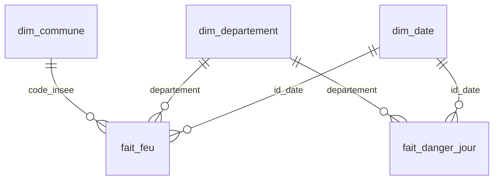

# Schéma de l'entrepôt

- **Rédigé par :** Arouna TOURE (responsable pipeline)
- **Date :** 2026-11-20
- **Construit par :** `src/pipeline.py` ; contrôles et chiffres dans `docs/pipeline/rapport-pipeline.md` ; tests dans `tests/test_pipeline.py`
- **Ticket :** #23

## Lancer le pipeline

Depuis la racine du dépôt :

```
pip install -r requirements.txt
python src/pipeline.py
python tests/test_pipeline.py
```

Le pipeline :

1. vérifie que la couche bronze est intacte (manifeste SHA-256, voir `docs/donnees-brutes.md`) ;
2. construit les trois couches dans `data/processed/entrepot.duckdb` ;
3. lance les contrôles de chaque couche et s'arrête au premier échec ;
4. exporte les tables de la couche or en Parquet dans `data/processed/or/` pour Power BI ;
5. écrit le rapport `docs/pipeline/rapport-pipeline.md`.

`data/processed/` n'est pas versionné : tout ce qu'il contient se reconstruit avec la commande ci-dessus, en quelques secondes. Le rapport est versionné : le relancer sur un autre poste doit donner un fichier identique.

## Les trois couches

| Couche | Schéma DuckDB | Contenu | Règle |
|---|---|---|---|
| Bronze | `bronze` | Les fichiers de `data/raw/`, toutes les valeurs en texte, telles qu'écrites | Aucune transformation. Chaque ligne garde `fichier_source` et `ligne_source` (numéro de ligne dans le fichier) |
| Argent | `argent` | Données typées et nettoyées | Texte vide devenu valeur manquante ; surfaces en nombres ; dates en dates ; codes de département sur deux caractères. Aucune valeur inventée ni complétée. Chaque ligne garde `fichier_source` et `ligne_source` de la couche bronze |
| Or | `gold` | Schéma en étoile pour le tableau de bord | Indicateurs calculés (hectares, classes de surface, jour visé par la prévision) |

Le schéma de la couche or s'appelle `gold` dans DuckDB, car `or` est un mot réservé du langage SQL.

`fichier_source` et `ligne_source` assurent le lineage : depuis n'importe quel feu ou jour de danger du tableau de bord, on retrouve la ligne exacte du fichier BDIFF ou Météo des forêts d'origine. `tests/test_pipeline.py` le vérifie sur un échantillon de 50 lignes de chaque fait.

## Couche or : schéma en étoile



Schéma en étoile strict : chaque fait est relié directement à chaque dimension, sans relation entre dimensions (la colonne `departement` de `dim_commune` est un simple attribut). Deux faits partagent les dimensions date et département : on peut ainsi croiser, pour un même jour et un même département, le niveau de danger prévu et les feux observés.

### fait_feu : un feu de forêt (BDIFF, 2006-2025, 2A et 2B)

| Colonne | Type | Description |
|---|---|---|
| `id_feu` | texte | Année et numéro BDIFF (`2006-7357`), clé unique |
| `id_date` | entier | Jour de la première alerte, `AAAAMMJJ` |
| `code_insee` | texte | Commune |
| `departement` | texte | `2A` ou `2B` |
| `date_alerte` | date et heure | Date de première alerte (heure à laquelle l'information arrive au CODIS) |
| `heure_alerte` | entier | Heure de la première alerte (0 à 23) |
| `surface_parcourue_ha` | décimal | Surface parcourue, en hectares |
| `surface_foret_ha` | décimal | Dont forêt, en hectares (manquante si non renseignée) |
| `surface_maquis_garrigues_ha` | décimal | Dont maquis et garrigues, en hectares (manquante si non renseignée) |
| `classe_surface` | texte | `moins de 1 ha`, `1 a 10 ha`, `10 a 50 ha` (50 ha inclus), `plus de 50 ha` |
| `cause` | texte | Colonne `Nature` de la BDIFF, `Non renseignee` si vide |
| `cause_renseignee` | booléen | Faux si la BDIFF ne donne pas de cause |
| `precision_surfaces` | texte | `Estimées` ou `Mesurées`, souvent manquante (la première ligne de l'export BDIFF signale que certaines données viennent de l'ancienne version du formulaire) |
| `deces_ou_batiments_touches` | texte | `Oui`, `Non` ou manquante |
| `fichier_source`, `ligne_source` | texte, entier | Origine dans la couche bronze |

### fait_danger_jour : niveau de danger prévu pour un jour et un département (Météo des forêts, saisons 2024 à 2026, 96 départements)

| Colonne | Type | Description |
|---|---|---|
| `id_date` | entier | Jour visé par la prévision, `AAAAMMJJ` |
| `departement` | texte | Code sur deux caractères |
| `niveau_j1` | entier | Niveau prévu la veille (bulletin publié le jour précédent), de 1 à 4 |
| `niveau_j2` | entier | Niveau prévu pour ce jour par le bulletin publié deux jours avant ; manquant le premier jour de chaque saison |
| `danger_eleve` | booléen | `niveau_j1` supérieur ou égal à 3 |
| `jour_publication` | date | Jour de publication du bulletin, heure de Paris |
| `fichier_source`, `ligne_source` | texte, entier | Origine dans la couche bronze |

Le jour visé suit la méthode de `src/calcul_diagnostic.py` : la date du fichier est l'heure de publication en UTC, convertie à l'heure de Paris ; `niveau_j1` vise le lendemain de la publication.

### dim_date : un jour du 1er janvier 2006 au 31 décembre 2026

`id_date` (clé, `AAAAMMJJ`), `date`, `annee`, `mois`, `nom_mois`, `jour_du_mois`, `jour_semaine`, `week_end`, `ete_juin_septembre`.

### dim_commune : une commune ayant eu au moins un feu

`code_insee` (clé), `nom_commune`, `departement`. 124 communes en Corse-du-Sud, 226 en Haute-Corse.

### dim_departement : un département de la Météo des forêts

`departement` (clé), `nom_departement`, `corse` (vrai pour 2A et 2B). 96 départements.

## Couche argent

| Table | Une ligne = | Colonnes |
|---|---|---|
| `argent.feu` | un feu de la BDIFF | Les 24 colonnes de l'export, renommées et typées (surfaces en m², date en date et heure), plus `id_feu`, `fichier_source`, `ligne_source` |
| `argent.bulletin_danger` | un bulletin de la Météo des forêts pour un département | `publication_utc`, `publication_paris`, `jour_publication`, `departement`, `nom_departement` (colonne `nom_dep`, ou `dep_nom` en 2025), `niveau_j1`, `niveau_j2`, `fichier_source`, `ligne_source` |

## Contrôles

Chaque contrôle arrête le pipeline s'il échoue. Liste et résultats : `docs/pipeline/rapport-pipeline.md`.

- **Bronze :** empreintes identiques au manifeste ; critères d'export BDIFF (type F, département, période) ; nombre de lignes égal au manifeste ; colonnes attendues.
- **Argent :** autant de lignes qu'en bronze ; clé unique ; dates dans la période exportée ; commune, date et surface renseignées ; aucune surface négative ; code INSEE cohérent avec le département ; un seul nom par code INSEE ; un bulletin par département et par jour ; niveaux entre 1 et 4.
- **Or :** aucune ligne de fait sans sa dimension ; clés uniques ; un niveau par jour et par département ; surface totale identique entre argent et or.

`tests/test_pipeline.py` vérifie en plus que les chiffres recalculés depuis la couche or sont ceux que `src/calcul_diagnostic.py` obtient directement sur les fichiers bruts : deux chemins de calcul différents donnent le même résultat.

## Utilisation dans Power BI

Dans Power BI Desktop : Obtenir des données, Parquet, puis choisir chaque fichier de `data/processed/or/`. Relations à créer dans la vue Modèle :

| De | Vers | Cardinalité |
|---|---|---|
| `fait_feu[id_date]` | `dim_date[id_date]` | plusieurs à un |
| `fait_feu[code_insee]` | `dim_commune[code_insee]` | plusieurs à un |
| `fait_feu[departement]` | `dim_departement[departement]` | plusieurs à un |
| `fait_danger_jour[id_date]` | `dim_date[id_date]` | plusieurs à un |
| `fait_danger_jour[departement]` | `dim_departement[departement]` | plusieurs à un |

Mention à placer sous chaque visuel : voir `docs/donnees-brutes.md`, section « Licences et citation ».
